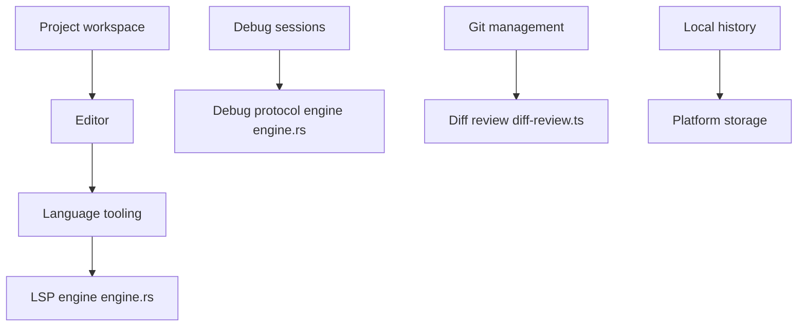

# 1lck/Lithe-IDEA

> Lightweight IDE for Java and Spring Boot, designed for reviewing, running and debugging AI-generated code.

## The problem
A heavy IDE takes up several gigabytes of memory when you only use it to review, navigate and check diffs.

## What it actually does
Navigation, search, Maven, running and debugging, Git diff review, local history, database connections. The README claims 300 to 400 MB of baseline memory. Language servers start on demand. macOS app in Swift, Windows version in React/Tauri, sharing a Rust core.

## How it is wired


## Trying it
```bash
brew tap lithe-idea/lithe https://github.com/Lithe-IDEA/Lithe-IDEA.git
brew install --cask lithe-idea/lithe/lithe
```
Otherwise, DMG or .exe installer from GitHub Releases.

## Cost and gotchas
Free. The macOS app may not be notarized: the README describes how to get around the warning. AI commit messages assume an external provider, not detailed.

## What it is not
Not a full replacement for IntelliJ: focused on Java and Spring Boot, young (created in August 2026). Not an AI tool in itself.

## Alternatives
IntelliJ IDEA, cited as the reference that Lithe aims to lighten.

## For you
Keep an eye on it: useful only if you review AI-generated Java; for data Python, a standard editor is enough.
