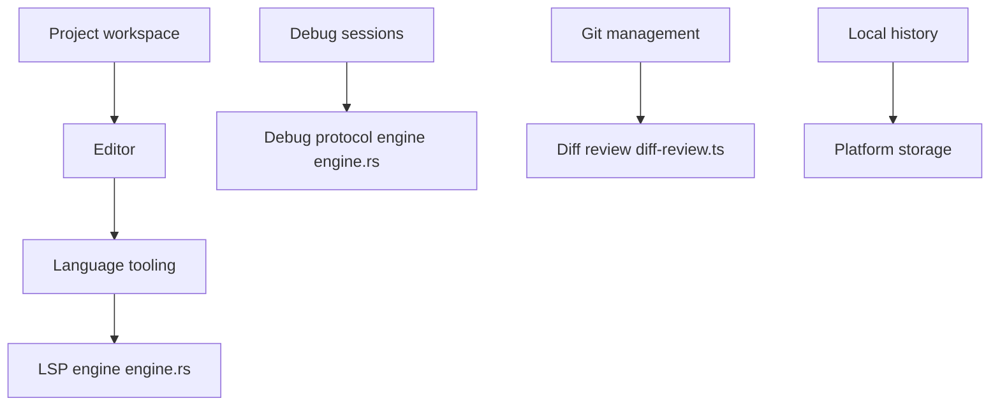

# 1lck/Lithe-IDEA

> IDE léger pour Java et Spring Boot, pensé pour relire, lancer et déboguer du code généré par IA.

## Le problème
Un IDE lourd occupe plusieurs gigaoctets de mémoire alors qu'on ne s'en sert plus que pour relire, naviguer et vérifier des diffs.

## Ce que ça fait vraiment
Navigation, recherche, Maven, exécution et débogage, revue de diffs Git, historique local, connexion aux bases de données. Le README annonce 300 à 400 Mo de mémoire de base. Les serveurs de langage démarrent à la demande. Application macOS en Swift, version Windows en React/Tauri, partageant un cœur Rust.

## Comment c'est branché


## Essayer
```bash
brew tap lithe-idea/lithe https://github.com/Lithe-IDEA/Lithe-IDEA.git
brew install --cask lithe-idea/lithe/lithe
```
Sinon, installeur DMG ou .exe depuis GitHub Releases.

## Coût et pièges
Gratuit. L'app macOS peut ne pas être notarisée : le README décrit comment contourner l'avertissement. Les messages de commit par IA supposent un fournisseur externe, non détaillé.

## Ce que ce n'est pas
Pas un remplaçant complet d'IntelliJ : ciblé Java et Spring Boot, jeune (créé en août 2026). Pas un outil d'IA en soi.

## Alternatives
IntelliJ IDEA, cité comme référence que Lithe veut alléger.

## Pour toi
Surveiller : utile seulement si tu relis du Java généré par IA ; pour du Python data, un éditeur courant suffit.

