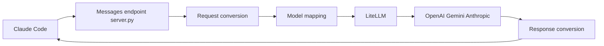

# 1rgs/claude-code-proxy

> Proxy server that makes Claude Code believe it is talking to an Anthropic client while using OpenAI or Gemini.

## The problem
Claude Code only speaks Anthropic's Messages API; it cannot be plugged as is into another provider.

## What it actually does
A FastAPI server (`server.py`) receives requests in Anthropic format, converts them through LiteLLM to OpenAI, Gemini (AI Studio key or Vertex AI) or Anthropic, then converts the response back, streamed or not, tools included. The names `haiku` and `sonnet` are mapped to `SMALL_MODEL` and `BIG_MODEL` according to `PREFERRED_PROVIDER`. One endpoint handles token counting.

## How it is wired


## Trying it
```bash
git clone https://github.com/1rgs/claude-code-proxy.git
cd claude-code-proxy
cp .env.example .env
uv run uvicorn server:app --host 0.0.0.0 --port 8082 --reload
ANTHROPIC_BASE_URL=http://localhost:8082 claude
```

## Cost and gotchas
API keys at your own expense with the chosen provider (OpenAI required by default, Gemini or Vertex if `PREFERRED_PROVIDER=google`). The model mappings in the README cite dated versions; review them in `.env`.

## What it is not
Not a quality equivalence: Claude Code is tuned for Claude models, and the others may use tools poorly. No license declared, so reuse of the code is uncertain.

## Alternatives
No alternative is named in the README; it builds on LiteLLM, which you can also use directly.

## For you
Worth watching: useful for testing Claude Code on other models, but with no license, a single author and 70 open issues.
