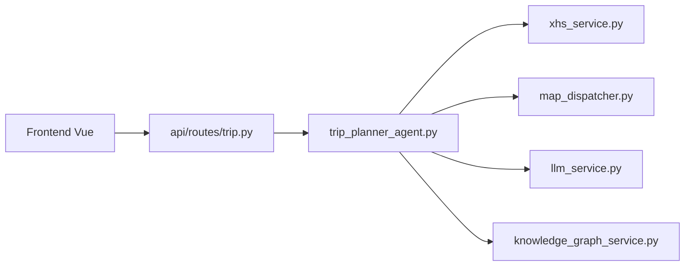

# 1sdv/TripStar

> Multi-agent trip planning web application (FastAPI and Vue), fed by Xiaohongshu travel journals.

## The problem
Planning a trip drowns you in information. Here, an LLM sorts guides, weather and hotels and produces a costed itinerary.

## What it actually does
The FastAPI backend launches an asynchronous task: attraction search on Xiaohongshu (cleaned up by an LLM then geocoded), weather and hotels via agents on Google Maps or AMap, then a final prompt produces a JSON with the itinerary, budget and knowledge graph. It includes a preference memory, multiple cities, three languages and a contextual chat. The interface follows the task over WebSocket.

## How it is wired


## Trying it
```bash
cp .env.example .env
cd backend && npm install
uv venv .venv && source .venv/bin/activate
uv pip install -r requirements.txt
uvicorn app.api.main:app --host 0.0.0.0 --port 8000 --reload
cd frontend && npm install && npm run dev
```

## Cost and gotchas
An LLM key, two AMap keys, a Google Maps key (credit card required), a Xiaohongshu cookie. Scraping Xiaohongshu with a personal cookie is fragile and may violate their terms of use (the README does not say so).

## What it is not
Not a hosted application: going online is in the to-do list. The output depends on an LLM-produced JSON that the code repairs through several steps.

## Alternatives
None cited; the README relies on the HelloAgents framework.

## For you
Ignore for production, but readable as an example of a multi-agent pipeline with tolerant JSON parsing; GPL-2.0 and scraping make reuse risky.
