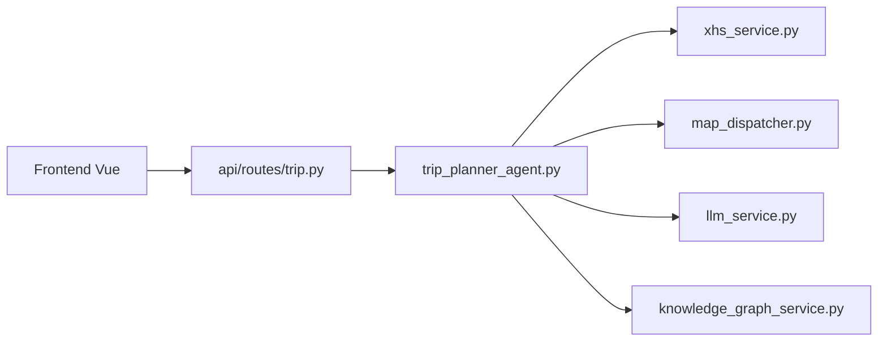

# 1sdv/TripStar

> Application web de planification de voyage multi-agents (FastAPI et Vue), nourrie par les carnets de voyage Xiaohongshu.

## Le problème
Planifier un voyage noie sous l'information. Ici, un LLM trie guides, météo et hôtels et produit un itinéraire chiffré.

## Ce que ça fait vraiment
Le backend FastAPI lance une tâche asynchrone : recherche d'attractions sur Xiaohongshu (purifiées par LLM puis géocodées), météo et hôtels via agents sur Google Maps ou AMap, puis un prompt final produit un JSON d'itinéraire, budget et graphe de connaissances. Il inclut une mémoire de préférences, plusieurs villes, trois langues et un chat contextuel. L'interface suit la tâche par WebSocket.

## Comment c'est branché


## Essayer
```bash
cp .env.example .env
cd backend && npm install
uv venv .venv && source .venv/bin/activate
uv pip install -r requirements.txt
uvicorn app.api.main:app --host 0.0.0.0 --port 8000 --reload
cd frontend && npm install && npm run dev
```

## Coût et pièges
Clé LLM, deux clés AMap, clé Google Maps (carte bancaire requise), cookie Xiaohongshu. Le scraping de Xiaohongshu avec cookie personnel est fragile et peut enfreindre leurs conditions d'usage (le README ne le dit pas).

## Ce que ce n'est pas
Pas une application hébergée : la mise en ligne figure dans les tâches à faire. La sortie dépend d'un JSON de LLM que le code répare par plusieurs étapes.

## Alternatives
Aucune citée ; le README s'appuie sur le framework HelloAgents.

## Pour toi
À ignorer en production, mais lisible comme exemple de pipeline multi-agents avec parsing JSON tolérant ; GPL-2.0 et scraping rendent la réutilisation risquée.

