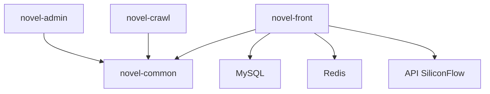

# 201206030/novel-plus

> Online novel publishing platform, in Chinese, with AI-assisted writing tools.

## The problem
Setting up a novel reading and publishing site with an author area, administration and scraping takes a big assembly effort.

## What it actually does
A Java CMS (Spring Boot, MyBatis, MySQL, Redis) with a reading portal, author area, back office and scraping module. It handles rankings, reviews, subscriptions, top-ups and several page templates. On the AI side: chapter rewriting, generated covers and a long-novel assistant (questions, outline, chapters, consistency). Everything goes through the SiliconFlow API, OpenAI-compatible, with two free models by default.

## How it is wired


## Trying it
```bash
export JWT_SECRET="$(openssl rand -base64 64 | tr -d '\n')"
bin/novel-front.sh start
```

## Cost and gotchas
You need Java, MySQL and Redis (Java is missing from the prerequisites list), plus a SiliconFlow key to add in the YAML. In production, `JWT_SECRET` is mandatory. The free models are of limited quality.

## What it is not
Not a generic AI tool: AI is only an experimental module. The README is in Chinese. The scraping tool is presented as reserved for test data.

## Alternatives
No alternative named in the README.

## For you
Ignore: a Chinese literary CMS whose AI part is just a call to a third-party API.
