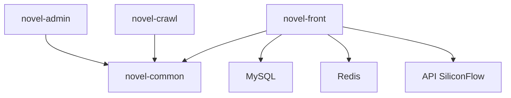

# 201206030/novel-plus

> Plateforme de publication de romans en ligne, en chinois, avec outils d'écriture assistés par IA.

## Le problème
Monter un site de lecture et de publication de romans avec espace auteur, administration et collecte demande un gros assemblage.

## Ce que ça fait vraiment
CMS Java (Spring Boot, MyBatis, MySQL, Redis) avec portail de lecture, espace auteur, back-office et module de collecte. Il gère classements, avis, abonnements, recharge et plusieurs modèles de pages. Côté IA : réécriture de chapitres, couvertures générées et assistant de roman long (questions, plan, chapitres, cohérence). Le tout passe par l'API de SiliconFlow, compatible OpenAI, avec deux modèles gratuits par défaut.

## Comment c'est branché


## Essayer
```bash
export JWT_SECRET="$(openssl rand -base64 64 | tr -d '\n')"
bin/novel-front.sh start
```

## Coût et pièges
Il faut Java, MySQL et Redis (Java hors liste de prérequis), plus une clé SiliconFlow à ajouter dans le YAML. En production, `JWT_SECRET` est obligatoire. Les modèles gratuits sont de qualité limitée.

## Ce que ce n'est pas
Pas un outil d'IA générique : l'IA n'est qu'un module expérimental. Le README est en chinois. L'outil de collecte est présenté comme réservé à des données de test.

## Alternatives
Aucune alternative nommée dans le README.

## Pour toi
Ignorer : un CMS littéraire chinois, dont la partie IA n'est qu'un appel à une API tierce.

