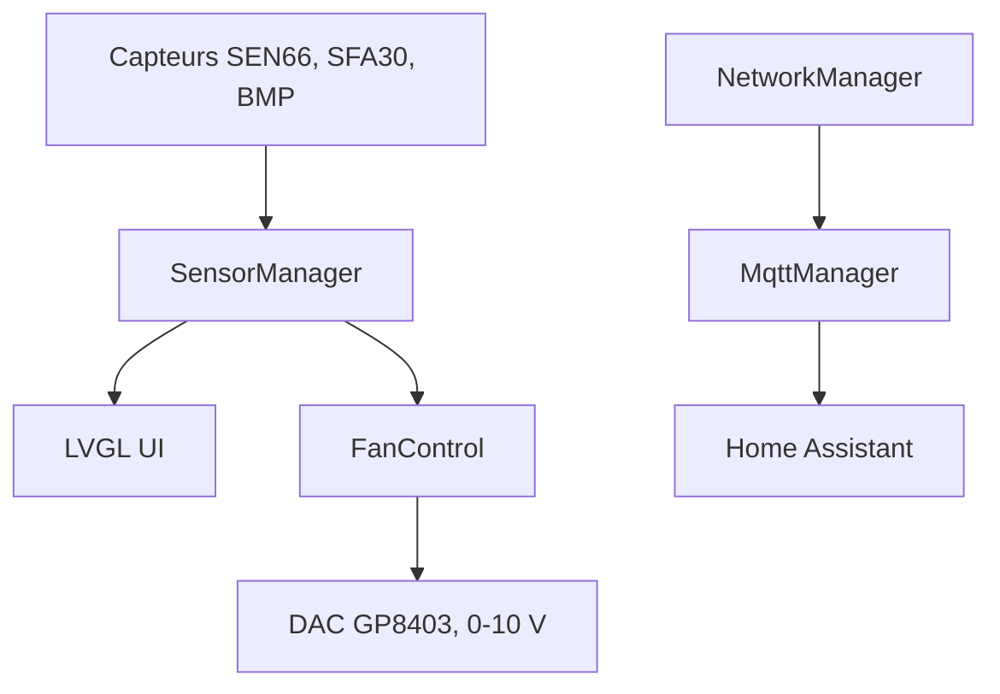

# 21cncstudio/project_aura

> ESP32-S3 firmware for a DIY air quality station with touchscreen, local dashboard and MQTT.

## The problem
Cheap air quality monitors are closed and cloud-dependent; here the goal is a local, open and repairable device.

## What it actually does
Reads particles, gases (CO2, CO, VOC, NOx, formaldehyde, optional gas) and climate over I2C, shows an LVGL interface, serves a web dashboard, publishes over MQTT with Home Assistant discovery and can drive a 0-10 V ventilation. OTA updates and automatic rollback to the last valid configuration after a crash.

## How it is wired


## Trying it
```powershell
./scripts/build_idf.ps1 -Profile 4_3 -IdfPath '<esp-idf-v6.1>' -ToolsPath '<idf-tools>'
```
The README recommends the web installer for the first flash instead.

## Cost and gotchas
Hardware to buy (16 MB Waveshare board, SEN66 sensor); the assembly guide is reserved for MakerWorld contributors. The web installer requires an Aura account. Never update the 7-inch version over OTA: risk of damaging the board.

## What it is not
Not a certified safety detector: the README states this for CO and oxygen. Not usable without the hardware.

## Alternatives
No alternative cited in the README.

## For you
Ignore: DIY hardware project; some link with telemetry and Home Assistant, but not with data or MLOps work.
