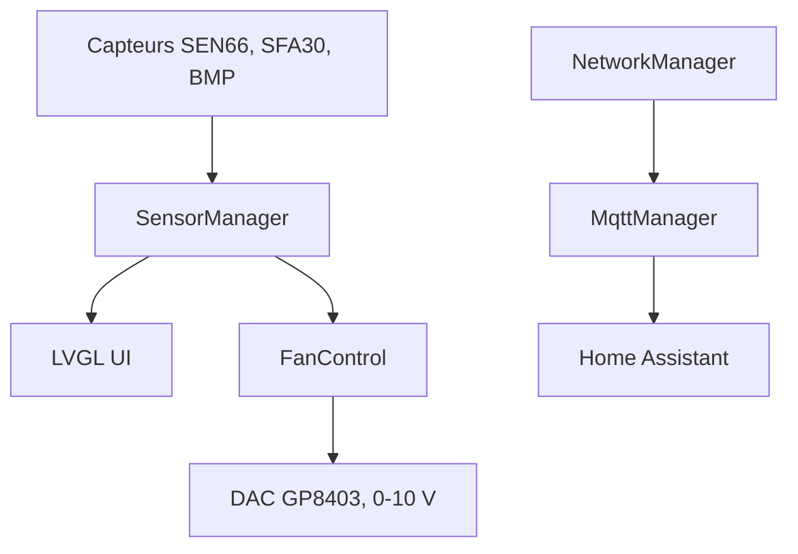

# 21cncstudio/project_aura

> Firmware ESP32-S3 d'une station de qualité de l'air DIY avec écran tactile, tableau de bord local et MQTT.

## Le problème
Les moniteurs de qualité de l'air bon marché sont fermés et dépendent d'un cloud ; ici on veut un appareil local, ouvert et réparable.

## Ce que ça fait vraiment
Lit particules, gaz (CO2, CO, COV, NOx, formaldéhyde, gaz optionnel) et climat via I2C, affiche une interface LVGL, sert un tableau de bord web, publie en MQTT avec découverte Home Assistant et peut piloter une ventilation 0-10 V. Mises à jour OTA et retour automatique à la dernière configuration valide après un plantage.

## Comment c'est branché


## Essayer
```powershell
./scripts/build_idf.ps1 -Profile 4_3 -IdfPath '<esp-idf-v6.1>' -ToolsPath '<idf-tools>'
```
Le README recommande plutôt l'installateur web pour le premier flash.

## Coût et pièges
Matériel à acheter (carte Waveshare 16 Mo, capteur SEN66) ; le guide de montage est réservé aux contributeurs MakerWorld. L'installateur web demande un compte Aura. Ne jamais mettre à jour la version 7 pouces par OTA : risque d'endommager la carte.

## Ce que ce n'est pas
Pas un détecteur de sécurité certifié : le README le précise pour le CO et l'oxygène. Pas utilisable sans le matériel.

## Alternatives
Aucune alternative citée dans le README.

## Pour toi
Ignorer : projet matériel de bricolage ; un lien avec la télémétrie et Home Assistant, mais pas avec un travail data ou MLOps.

