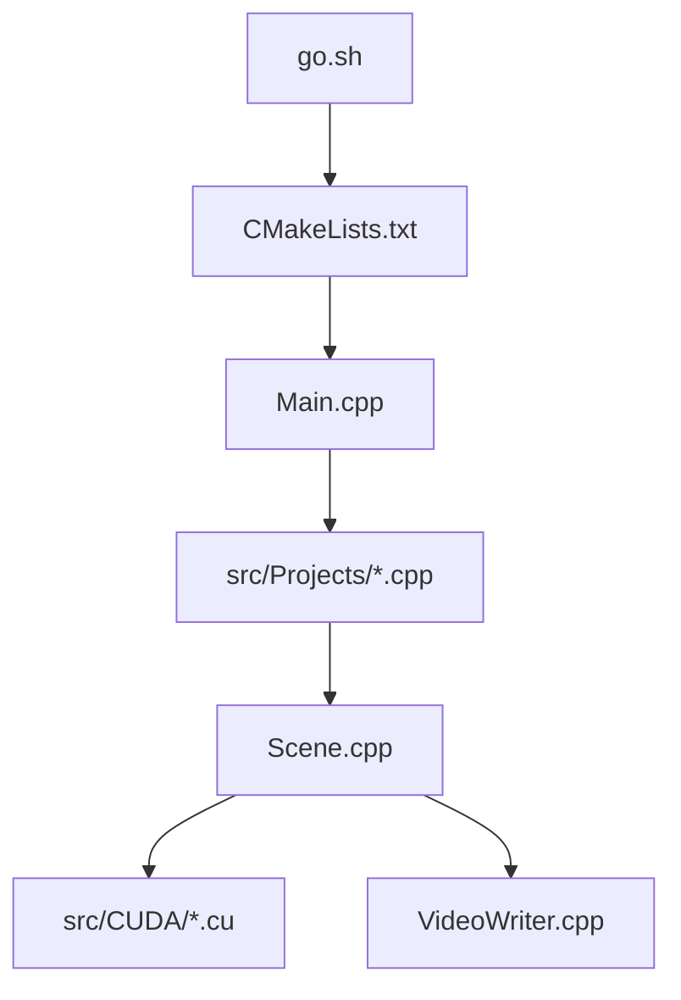

# 2swap/swaptube

> Homemade C++ engine for making animated math videos, used by the author for his YouTube channel.

## The problem
Producing animated explainer videos requires synchronizing images, voice and subtitles by hand.

## What it actually does
You write a C++ project split into macroblocks (one sentence of narration) and microblocks (visual transitions). The engine handles timing, numeric state, rendering via CUDA or HIP, encoding via FFmpeg, subtitles, LaTeX through MicroTeX and a voice recorder. A quick low-resolution test precedes each full render.

## How it is wired


## Trying it
```bash
./go.sh LambdaDemo 640 360 30
./test.sh
```

## Cost and gotchas
You need an NVIDIA (CUDA) or AMD (HIP) card, FFmpeg 5 or later, CMake, Ninja, MicroTeX and librsvg. Tested on Linux only; Windows goes through WSL2. CPU encoding with libx264 is possible (`-e`) but slower.

## What it is not
It is not consumer video-editing software: it is a creator's personal tool, with no guarantee of evolution.

## Alternatives
No alternative named in the README.

## For you
Ignore: useful only if you want to produce math videos in code, with no direct connection to a data / AI workflow.
