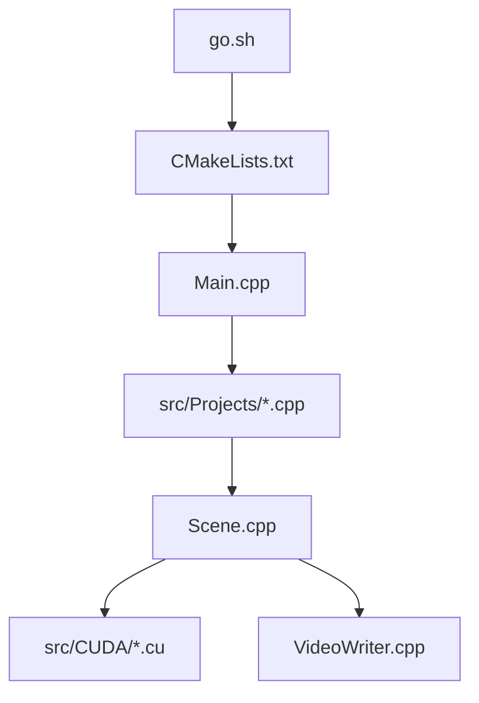

# 2swap/swaptube

> Moteur C++ maison pour fabriquer des vidéos mathématiques animées, utilisé par l'auteur pour sa chaîne YouTube.

## Le problème
Produire des vidéos d'explication animées demande de synchroniser images, voix et sous-titres à la main.

## Ce que ça fait vraiment
On écrit un projet C++ découpé en macroblocs (une phrase de narration) et microblocs (transitions visuelles). Le moteur gère le temps, l'état numérique, le rendu par CUDA ou HIP, l'encodage via FFmpeg, les sous-titres, le LaTeX par MicroTeX et un enregistreur de voix. Un test rapide à basse résolution précède chaque rendu complet.

## Comment c'est branché


## Essayer
```bash
./go.sh LambdaDemo 640 360 30
./test.sh
```

## Coût et pièges
Il faut une carte NVIDIA (CUDA) ou AMD (HIP), FFmpeg 5 ou plus, CMake, Ninja, MicroTeX et librsvg. Testé sous Linux seulement ; Windows passe par WSL2. L'encodage CPU en libx264 est possible (`-e`) mais plus lent.

## Ce que ce n'est pas
Ce n'est pas un logiciel de montage grand public : c'est l'outil personnel d'un créateur, sans garantie d'évolution.

## Alternatives
Aucune alternative nommée dans le README.

## Pour toi
À ignorer : utile seulement si tu veux produire des vidéos de maths en code, sans rapport direct avec un flux data / IA.

