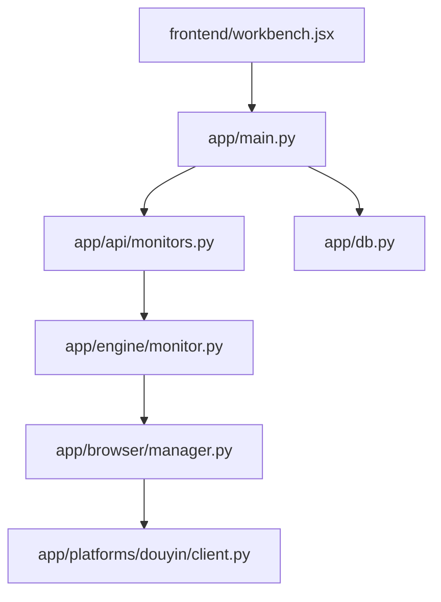

# 3441293738/creatorhub

> Local workstation to manage, monitor and download content across eight Chinese and global social platforms.

## The problem
Managing accounts, collecting comments and publishing on Douyin, Xiaohongshu, TikTok or Instagram forces you to juggle as many interfaces.

## What it actually does
A local web interface (React) calls a FastAPI API. Monitors drive a browser manager, which uses a platform-specific client for each platform (Douyin, Xiaohongshu...). Features: keyword collection, comment monitoring, download, publishing, direct messages. Data, cookies and media stay local in SQLite.

## How it is wired


## Trying it
```bash
git clone https://github.com/3441293738/creatorhub.git
cd creatorhub
chmod +x start.sh
./start.sh
```

## Cost and gotchas
Free; Python 3.10+ and a graphical desktop for the source version. No license is declared in the catalog. The README provides no accounts, cookies or proxies, and contains a sponsor box for a residential proxy service.

## What it is not
Not a data analysis tool: it automates browsers on platforms whose rules may forbid this use. The docs are in Chinese.

## Alternatives
No alternative named in the README.

## For you
Ignore: social media automation with no declared license, of no interest for data or MLOps work.
