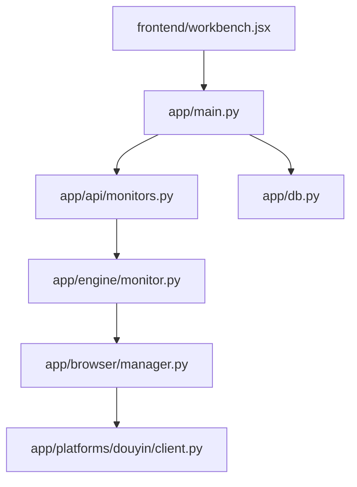

# 3441293738/creatorhub

> Poste de travail local pour gérer, surveiller et télécharger du contenu sur huit plateformes sociales chinoises et mondiales.

## Le problème
Gérer des comptes, collecter des commentaires et publier sur Douyin, Xiaohongshu, TikTok ou Instagram oblige à jongler entre autant d'interfaces.

## Ce que ça fait vraiment
Une interface web locale (React) appelle une API FastAPI. Des moniteurs pilotent un gestionnaire de navigateur, qui utilise un client propre à chaque plateforme (Douyin, Xiaohongshu…). Fonctions : collecte par mot-clé, surveillance de commentaires, téléchargement, publication, messages privés. Données, cookies et médias restent en local dans SQLite.

## Comment c'est branché


## Essayer
```bash
git clone https://github.com/3441293738/creatorhub.git
cd creatorhub
chmod +x start.sh
./start.sh
```

## Coût et pièges
Gratuit ; Python 3.10+ et un bureau graphique pour la version source. Aucune licence n'est déclarée dans le catalogue. Le README ne fournit ni comptes, ni cookies, ni proxys, et contient un encart sponsor pour un service de proxys résidentiels.

## Ce que ce n'est pas
Ce n'est pas un outil d'analyse de données : il automatise des navigateurs sur des plateformes dont les règles peuvent interdire cet usage. La doc est en chinois.

## Alternatives
Aucune alternative nommée dans le README.

## Pour toi
À ignorer : automatisation de réseaux sociaux sans licence déclarée, sans intérêt pour un travail de données ou de MLOps.

