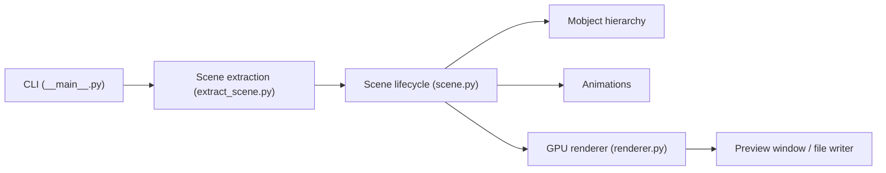

# 3b1b/manim

> Engine for programmed mathematical animations, in the personal version of the author of 3Blue1Brown.

## The problem
Illustrating math concepts with a precise, frame-by-frame animation, without video editing software.

## What it actually does
You write scenes in Python (mobjects, animations, camera); the `manimgl` CLI imports the module, picks the `Scene` classes and plays the scene in an interactive preview or writes it to video or image via FFmpeg. Rendering goes through OpenGL with WGSL shaders; LaTeX (optional) and Pango (Linux) handle text. The package is called `manimgl`, not `manim`.

## How it is wired


## Trying it
```bash
pip install manimgl
manimgl
manimgl example_scenes.py OpeningManimExample
```

## Cost and gotchas
Free. You need Python 3.10+, FFmpeg, OpenGL, and LaTeX if you want formulas (MacTeX weighs about 6 GB, BasicTeX is lighter). The README warns not to mix its instructions with those of the community version.

## What it is not
It is not the community version (Manim Community), which is a more stable fork, better tested and easier to get started with according to the README. The documentation is described as "in progress".

## Alternatives
- Manim Community (2020 fork): more stable, better tested, responsive to contributions.

## For you
Worth watching: interesting for producing explanatory animations (ML, math), but the installation is heavy and the community version is safer to start with.
