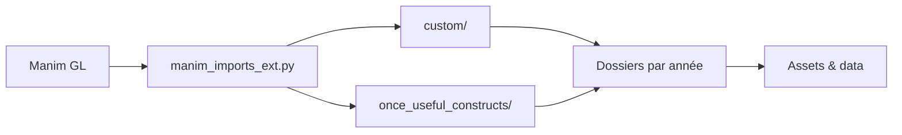

# 3b1b/videos

> Manim code for 3Blue1Brown's math videos, to learn from or draw inspiration from.

## The problem
Seeing how educational math animations are built requires access to the real sources.

## What it actually does
Python scenes rendered by `manimgl`, organized by year (`_2015` to `_2026`). A `custom/` layer provides the channel's style, `once_useful_constructs/` holds reusable helpers, and `manim_imports_ext.py` centralizes the imports. The README also describes an interactive workflow with checkpoints under Sublime.

## How it is wired


## Trying it
```bash
sudo apt install texlive texlive-latex-extra texlive-fonts-extra texlive-science
git clone git@github.com:3b1b/videos.git
cd videos
manimgl e_field.py WavesIn3D
```

## Cost and gotchas
Free. The content is under CC BY-NC-SA 4.0, so commercial use is excluded; GitHub does not recognize the license. Older projects may not run with recent versions of manim.

## What it is not
Not a library: it is a repository of examples, with `manimgl` to be installed from source. The Manim library itself is under MIT.

## Alternatives
ManimCommunity, the community-maintained version, cited by the README.

## For you
Keep an eye on it: a rich source of examples for visualizing AI concepts (transformers, neural networks), but not commercializable.
