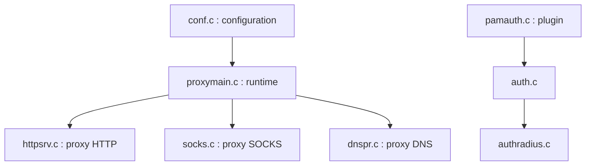

# 3proxy/3proxy

> Small multi-protocol proxy server (HTTP, SOCKS, FTP, DNS...) with authentication and traffic limits.

## The problem
You need to relay, filter or chain network connections with access rules, without installing a heavy stack.

## What it actually does
A single executable handles HTTP/HTTPS proxy, SOCKS 4/5, FTP, POP3, SMTP, SNI, DNS cache, TCP and UDP port forwarding. Rules (ACLs) filter by user, IP, destination, time of day; you can limit bandwidth, daily volume and connections. It chains parent proxies, logs (file, syslog, ODBC, RADIUS) and accepts plugins (PAM, LDAP, SSL).

## How it is wired


## Trying it
```bash
git clone https://github.com/z3apa3a/3proxy
cd 3proxy
ln -s Makefile.Linux Makefile
make
sudo make install
add3proxyuser username password [day_limit] [bandwidth]
```

## Cost and gotchas
Free. C compilation or deb/rpm packages, Docker image available. By default SOCKS listens on 0.0.0.0:1080 and HTTP on 0.0.0.0:3128 with basic authentication and no users. The license is "present but unidentified" per GitHub: re-read it before commercial use.

## What it is not
Not a graphical interface: everything goes through a configuration file. UDP listening and SOCKS BIND features require ephemeral ports, which complicates Docker.

## Alternatives
No alternative named in the README.

## For you
Worth watching: handy for relaying lab traffic or chaining exits, but check the license and never expose it without authentication.
