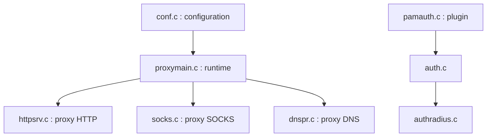

# 3proxy/3proxy

> Petit serveur proxy multi-protocoles (HTTP, SOCKS, FTP, DNS…) avec authentification et limites de trafic.

## Le problème
Il faut relayer, filtrer ou chaîner des connexions réseau avec des règles d'accès, sans installer une pile lourde.

## Ce que ça fait vraiment
Un seul exécutable gère proxy HTTP/HTTPS, SOCKS 4/5, FTP, POP3, SMTP, SNI, cache DNS, redirection de ports TCP et UDP. Les règles (ACL) filtrent par utilisateur, IP, destination, horaire ; on limite débit, volume quotidien et connexions. Il chaîne des proxys parents, journalise (fichier, syslog, ODBC, RADIUS) et accepte des plugins (PAM, LDAP, SSL).

## Comment c'est branché


## Essayer
```bash
git clone https://github.com/z3apa3a/3proxy
cd 3proxy
ln -s Makefile.Linux Makefile
make
sudo make install
add3proxyuser username password [day_limit] [bandwidth]
```

## Coût et pièges
Gratuit. Compilation C ou paquets deb/rpm, image Docker disponible. Par défaut SOCKS écoute sur 0.0.0.0:1080 et HTTP sur 0.0.0.0:3128 avec authentification de base et aucun utilisateur. La licence est « présente mais non identifiée » par GitHub : à relire avant usage commercial.

## Ce que ce n'est pas
Ce n'est pas une interface graphique : tout passe par un fichier de configuration. Les fonctions d'écoute UDP et SOCKS BIND demandent des ports éphémères, ce qui complique Docker.

## Alternatives
Aucune alternative nommée dans le README.

## Pour toi
À surveiller : pratique pour relayer le trafic d'un laboratoire ou chaîner des sorties, mais vérifie la licence et ne l'expose jamais sans authentification.

