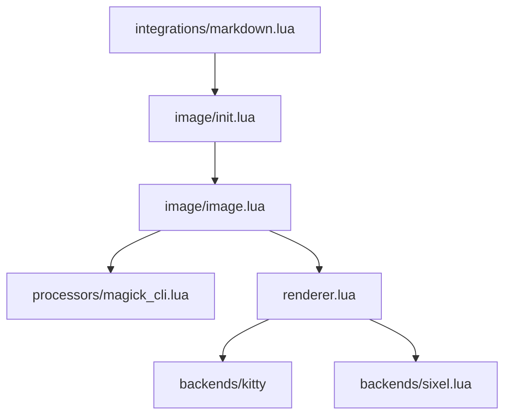

# 3rd/image.nvim

> Neovim plugin that displays images in the editor via the Kitty protocol, Sixel or ueberzugpp.

## The problem
Neovim does not display images in a Markdown or Neorg document, which breaks the note-taking flow.

## What it actually does
Detects images in buffers (markdown, asciidoc, neorg, rst, typst, html/css), resizes them with ImageMagick (CLI or Lua binding), then renders them through the chosen backend, including inside Tmux. It also exposes a Lua API to display, move or tint images.

## How it is wired


## Trying it
```bash
nvim --clean -c ":luafile minimal-setup.lua"
```

## Cost and gotchas
Requires ImageMagick, a compatible terminal (Kitty recommended) and a Tmux setting. The magick_cli mode goes through a shell, with a flagged risk on untrusted input.

## What it is not
Not a standalone image viewer. WezTerm is not officially supported; Sixel is slow.

## Alternatives
- hologram.nvim: ancestor cited in the credits.

## For you
Ignore: editor comfort, useful only if you write your notes in Neovim with Kitty.
