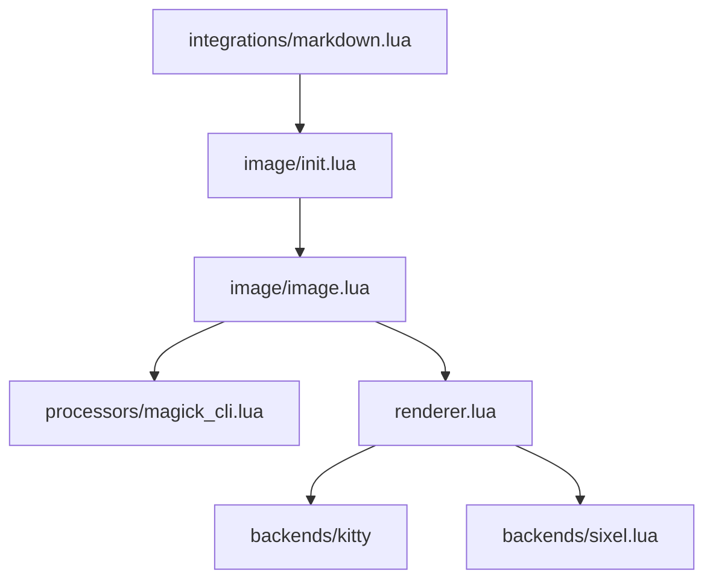

# 3rd/image.nvim

> Plugin Neovim qui affiche des images dans l'éditeur via le protocole Kitty, Sixel ou ueberzugpp.

## Le problème
Neovim n'affiche pas les images d'un document Markdown ou Neorg, ce qui coupe le flux de notes.

## Ce que ça fait vraiment
Détecte les images dans les buffers (markdown, asciidoc, neorg, rst, typst, html/css), les redimensionne avec ImageMagick (CLI ou binding Lua) puis les rend via le backend choisi, y compris dans Tmux. Expose aussi une API Lua pour afficher, déplacer ou colorer des images.

## Comment c'est branché


## Essayer
```bash
nvim --clean -c ":luafile minimal-setup.lua"
```

## Coût et pièges
Demande ImageMagick, un terminal compatible (Kitty recommandé) et un réglage Tmux. Le mode magick_cli passe par un shell, avec un risque signalé sur des entrées non fiables.

## Ce que ce n'est pas
Pas un lecteur d'images autonome. WezTerm n'est pas officiellement supporté ; Sixel est lent.

## Alternatives
- hologram.nvim : ancêtre cité en crédits.

## Pour toi
Ignorer : confort d'éditeur, utile seulement si tu écris tes notes dans Neovim avec Kitty.

