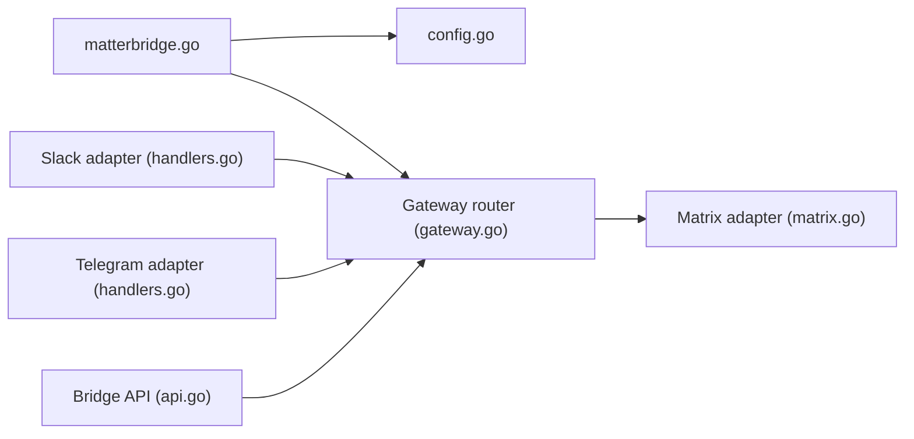

# 42wim/matterbridge

> Chat bridge that links several messaging platforms, configured in TOML.

## The problem
Teams spread across Slack, Discord, IRC, Matrix, Telegram, etc. cannot talk to each other.

## What it actually does
Protocol adapters that normalize messages into a gateway router and redistribute them. Message editing and deletion, threads, attachments, nickname and avatar spoofing, private groups, multiple gateways, an API for third-party integrations.

## How it is wired


## Trying it
```bash
go install github.com/42wim/matterbridge
matterbridge -conf matterbridge.toml
```

## Cost and gotchas
Free; bot accounts needed on each platform. A full build takes about 3 GB of RAM (0.5 GB without the Teams bridge).

## What it is not
Last push December 2024: messaging APIs change, so some bridges may be broken (not verified).

## Alternatives
None named as a replacement; a Mattermost plugin is cited among related projects.

## For you
Ignore for your watch: relevant only if you need to relay alerts between messaging platforms, and the project is slowing down.
