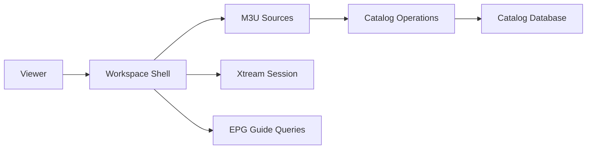

# 4gray/iptvnator

> Free IPTV player for macOS, Windows, Linux and the browser, which plays your own lists.

## The problem
Bringing M3U lists, Xtream Codes accounts and Stalker portals together in a single interface with a program guide.

## What it actually does
It imports playlists and shows live channels, movies and series, the XMLTV guide and history. Playback goes through web players, MPV, VLC or IINA. A web version in Docker and an experimental TV app exist.

## How it is wired


## Trying it
```bash
docker compose -f docker/docker-compose.yml up --build -d
```

## Cost and gotchas
Free. It provides no content: subscription or playlists are up to you. Optional personal TMDB key for metadata.

## What it is not
Not a channel service: it is a player. The web version has no downloads or external player.

## Alternatives
No alternative named in the README.

## For you
Ignore: an entertainment app unrelated to data / AI / MLOps work.
