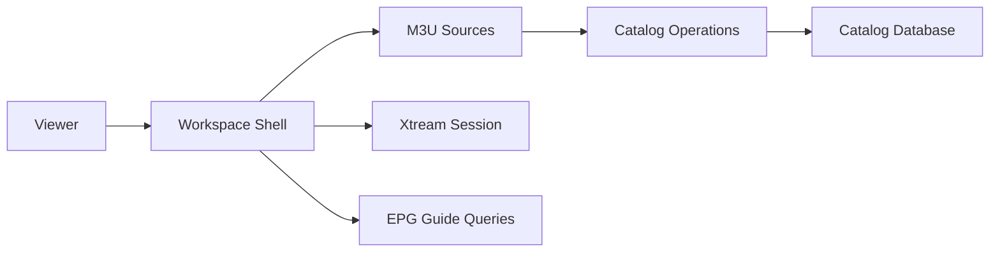

# 4gray/iptvnator

> Lecteur IPTV libre pour macOS, Windows, Linux et navigateur, qui lit tes propres listes.

## Le problème
Regrouper des listes M3U, comptes Xtream Codes et portails Stalker dans une seule interface avec guide des programmes.

## Ce que ça fait vraiment
Il importe des playlists, affiche chaînes en direct, films et séries, le guide XMLTV et l'historique. La lecture passe par des lecteurs web, MPV, VLC ou IINA. Une version web en Docker et une application expérimentale pour télévision existent.

## Comment c'est branché


## Essayer
```bash
docker compose -f docker/docker-compose.yml up --build -d
```

## Coût et pièges
Gratuit. Il ne fournit aucun contenu : abonnement ou playlists à ta charge. Clé TMDB personnelle optionnelle pour les métadonnées.

## Ce que ce n'est pas
Ce n'est pas un service de chaînes : c'est un lecteur. La version web n'a ni téléchargements ni lecteur externe.

## Alternatives
Aucune alternative nommée dans le README.

## Pour toi
À ignorer : application de divertissement sans rapport avec un travail data / IA / MLOps.

