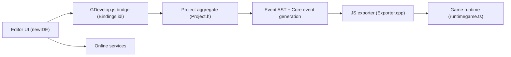

# 4ian/GDevelop

> No-code, event-based 2D and 3D game editor, publishable on mobile, desktop and web.

## The problem
Creating a game normally requires programming; a visual tool lowers the barrier for designers and beginners.

## What it actually does
An editor (React, Electron) manipulates a C++ project model (Core) exposed to JavaScript through WebAssembly (GDevelop.js). Game rules are written as condition/action events, which a generator converts into JavaScript run by the GDJS engine (PixiJS for 2D, Three.js for 3D). Extensions add objects and behaviors, including Box2D or Jolt physics in WebAssembly. Online services (build, cloud, AI) are separate from the engine.

## How it is wired

## Trying it
No usage command in the README: it points to the home page to download the application. Contributing follows the "Technical architecture" section and the dedicated docs.

## Cost and gotchas
The catalog flags a license that is present but not identified by GitHub: check it before any commercial use. Some online services are offered as paid plans (Asset Store, services for professionals) according to the README. 625 open issues.

## What it is not
It is not only an engine: the editor, the engine and cloud services form a whole. "No-code" does not rule out an event-based model that must be learned.

## Alternatives
- No alternative named in the README.

## For you
Ignore: game creation tool, outside the data/AI/MLOps scope, with a license to clarify.
