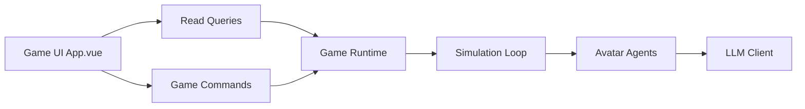

# 4thfever/cultivation-world-simulator

> Cultivation world simulator where every character is an LLM agent and the player is the "Dao".

## The problem
Cultivation games are scripted or rely on simplistic state machines; living worlds are out of reach for readers.

## What it actually does
Each cultivator is an LLM-driven agent, with personality, memory and relationships, bounded by rules (realms, sects, items, events such as auctions). The player observes and intervenes. Python backend simulating avatars, sects and the world, Vue front end, control API `/api/v1/query/*` and `/api/v1/command/*` for external agents. Configurable models: DeepSeek, MiniMax, Ollama. README in Chinese.

## How it is wired


## Trying it
```bash
pip install -r requirements.txt
cd web && npm install && cd ..
python src/server/main.py --dev
```

## Cost and gotchas
A model provider is required from the first game (per-token billing if API). Python 3.10+ and Node 18+. Docker deployment is marked "untested"; a desktop version is on the Epic Games Store.

## What it is not
Not a work tool: a simulation game. A license is present but unidentified, to be checked before reuse.

## Alternatives
- No alternative named in the README.

## For you
Ignore for your data/MLOps work; only the example of rule-bounded multi-agent simulation may inspire.
