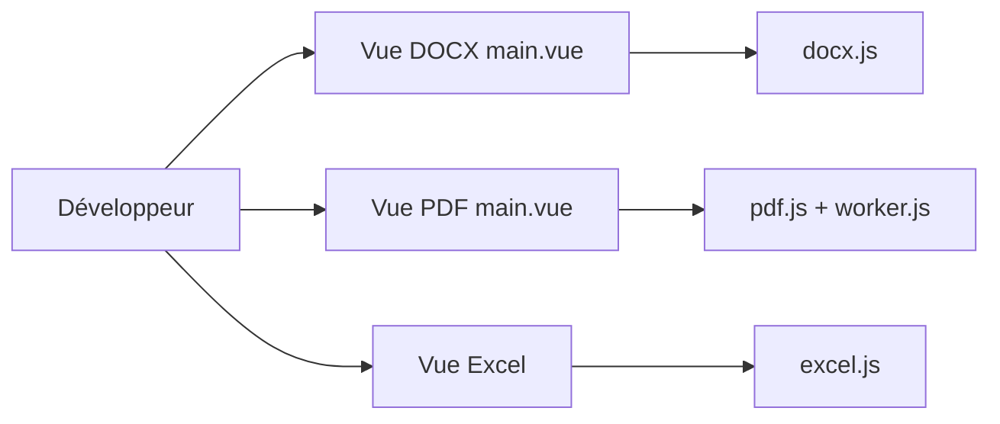

# 501351981/vue-office

> Vue 2/3 components to preview docx, xlsx, pdf and pptx files in the browser.

## The problem
Displaying Office documents and PDFs in a web application forces you to assemble one library per format.

## What it actually does
Four npm packages (`@vue-office/docx`, `excel`, `pdf`, `pptx`). You pass a URL, an ArrayBuffer or a Blob to the `src` attribute. docx rendering uses docx-preview, pdf uses pdfjs with a virtual list, excel uses exceljs and x-data-spreadsheet, pptx uses an in-house library. `rendered` and `error` events. Also works outside Vue in native JavaScript.

## How it is wired


## Trying it
```bash
npm install @vue-office/docx vue-demi@0.14.6
npm install @vue-office/excel vue-demi@0.14.6
npm install @vue-office/pdf vue-demi@0.14.6
npm install @vue-office/pptx vue-demi@0.14.6
```

## Cost and gotchas
Free, but the code of the pptx library is paid to the author (source on request). Since December 2024 the author says they no longer handle issues quickly; 222 open issues. Vue 2.6 requires `@vue/composition-api`.

## What it is not
Not a document editor: preview only. docx anomalies belong to docx-preview and are not handled here. README in Chinese.

## Alternatives
No alternative named in the README (the underlying libraries are cited there as dependencies).

## For you
Ignore: front-end preview component unrelated to data/AI; only worth considering for a Vue dashboard that displays documents.
