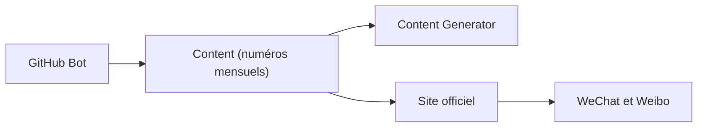

# 521xueweihan/HelloGitHub

> Monthly Chinese-language review of fun, beginner-friendly open source projects on GitHub.

## The problem
Discovering accessible open source projects without spending hours browsing GitHub, especially for a beginner Chinese-speaking audience.

## What it actually does
An issue is published on the 28th of each month, with "interesting and entry-level" projects, open source books, practical projects and enterprise projects. The README lists the issues (from issue 86 to issue 125 in the table provided), links to the official website and the WeChat account, invites people to suggest projects and shows sponsors (UCloud, OpenIM, 七牛云, OfoxAI). The README is short: minimal sheet.

## How it is wired
The graph provided is an intent diagram (content, automation and distribution layers), not a verified wiring; nodes are based on the file tree.

## Trying it
No command documented in the README.

## Cost and gotchas
Free. Content is in Chinese, so reading it requires a translation. No license declared.

## What it is not
Not a tool nor an exhaustive list: an editorial selection published monthly, with no technical criteria published in this README.

## Alternatives
No alternative named in the README.

## For you
Ignore: your filtered data/AI GitHub watch already exists, and this review is general-purpose, in Chinese and unlicensed.
