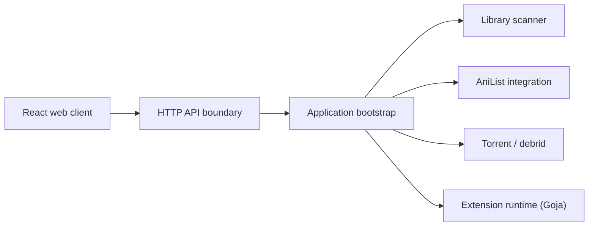

# 5rahim/seanime

> Media server with a web interface and desktop app for an anime and manga library.

## The problem
Managing a local library of anime and manga, its downloads and playback from a single tool.

## What it actually does
A Go server (`main.go`) with an HTTP API and WebSockets, a library scanner that needs no strict naming convention, AniList integration, torrent search and download (qBittorrent, Transmission, debrid services), direct playback or transcoding, external players MPV/VLC/MPC-HC. JavaScript extensions run by Goja; a React client and an Electron client "Denshi".

## How it is wired


## Trying it
```bash
# Installation : voir le guide d'installation lié au README.
# Compilation : Node.js et Go requis (commandes non détaillées).
```

## Cost and gotchas
Free; some debrid providers are paid on the third-party side. Extensions are unaffiliated and may be removed for copyright reasons.

## What it is not
Provides and hosts no content. A one-person project: no MyAnimeList/Trakt support nor translation planned.

## Alternatives
- The README points to "other tools" without naming any.

## For you
Ignore: a hobby topic, outside the data/AI/MLOps scope, and dependent on a single maintainer.
