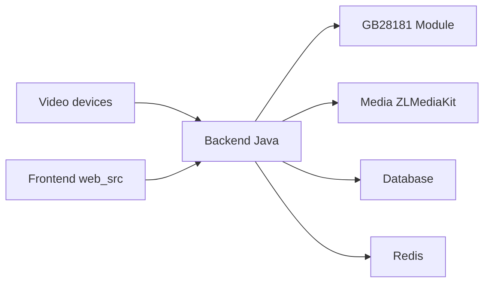

# 648540858/wvp-GB28181-pro

> Ready-to-use video platform for cameras and NVRs following the Chinese GB28181 and JT808/1078 standards.

## The problem
Connecting IP cameras and NVRs (Hikvision, Dahua, Uniview) to a surveillance platform compliant with Chinese standards.

## What it actually does
Java backend (GB28181 SIP signaling, JT1078 module, media management, SQL storage) driven together with ZLMediaKit for the streams, a Vue interface, Redis for messaging. Plugin-free playback, cascading between platforms, scheduled recording, map, more than 50,000 devices in testing according to the author. Some advanced features are "closed source" (paid).

## How it is wired

## Trying it
README without commands: points to doc.wvp-pro.cn. Not documented here.

## Cost and gotchas
Partially open source: ONVIF, ISUP, the Dahua SDK and GB28181-2022 belong to the closed version, available by contacting via email. Third-party dependencies to check for commercial use.

## What it is not
Not a video analytics tool nor AI-based detection. README entirely in Chinese.

## Alternatives
ZLMediaKit is the media server used, not an alternative.

## For you
Ignore: surveillance platform tied to local standards, unrelated to data/AI.
