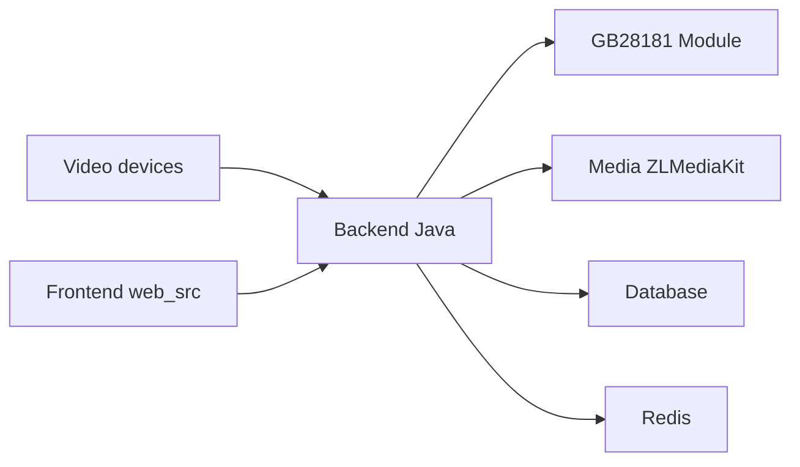

# 648540858/wvp-GB28181-pro

> Plateforme vidéo prête à l'emploi pour caméras et NVR aux normes chinoises GB28181 et JT808/1078.

## Le problème
Brancher des caméras IP et NVR (Hikvision, Dahua, Uniview) sur une plateforme de surveillance conforme aux normes chinoises.

## Ce que ça fait vraiment
Backend Java (signalisation SIP GB28181, module JT1078, gestion des médias, stockage SQL) piloté avec ZLMediaKit pour les flux, interface Vue, Redis pour la messagerie. Lecture sans plugin, cascade entre plateformes, enregistrement planifié, carte, plus de 50 000 appareils en test selon l'auteur. Des fonctions avancées sont « closed source » (payantes).

## Comment c'est branché

## Essayer
README sans commande : renvoie à doc.wvp-pro.cn. Non documenté ici.

## Coût et pièges
Open source partiel : ONVIF, ISUP, SDK Dahua et GB28181-2022 relèvent de la version fermée, sur contact par courriel. Dépendances tierces à vérifier en usage commercial.

## Ce que ce n'est pas
Pas un outil d'analyse vidéo ni de détection par IA. README entièrement en chinois.

## Alternatives
ZLMediaKit est le serveur média utilisé, pas une alternative.

## Pour toi
À ignorer : plateforme de surveillance liée à des normes locales, sans lien avec data/IA.

