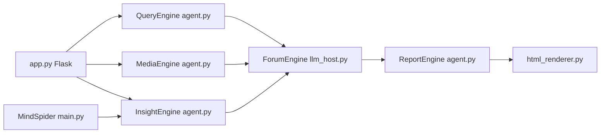

# 666ghj/BettaFish

> Multi-agent system for opinion analysis on Chinese social networks, producing HTML reports.

## The problem
Tracking public opinion across dozens of platforms and millions of comments is beyond manual analysis.

## What it actually does
Three agents in parallel — QueryEngine (web/news), MediaEngine (multimodal), InsightEngine (private database + sentiment analysis) — debate through a ForumEngine driven by an LLM "moderator". ReportEngine then assembles a report: template choice, outline, word budget, JSON chapters validated by an IR, HTML/PDF rendering. MindSpider crawls Weibo, Xiaohongshu and Douyin via Playwright. Sentiment models are provided (BERT LoRA, Qwen, classic ML).

## How it is wired


## Trying it
```bash
docker compose up -d
pip install -r requirements.txt
playwright install chromium
python app.py
python report_engine_only.py --query "土木工程行业分析"
```

## Cost and gotchas
OpenAI-compatible API keys for each agent, PostgreSQL, Chromium. The README forbids any commercial use, which conflicts with the GPL-2.0: to be clarified. Crawling platforms puts the legal responsibility on you.

## What it is not
Not a tool for Western networks: sources and models are centered on China. Not a free license for professional use, given the warning.

## Alternatives
None named (MiroFish is the same author's follow-up).

## For you
Multi-agent architecture + report IR to study; not to deploy in a company.
