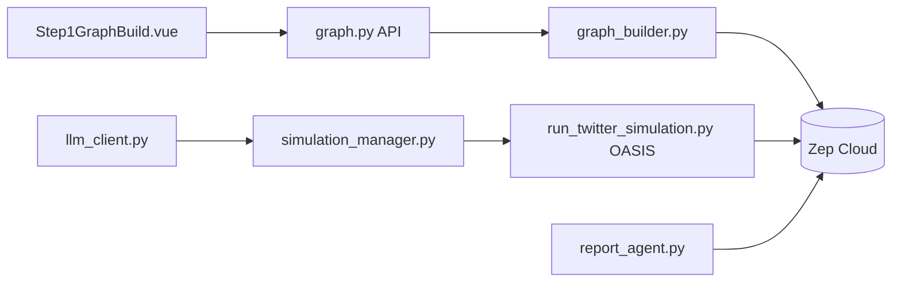

# 666ghj/MiroFish

> A multi-agent simulator that builds a social world from documents to generate "predictions".

## The problem
To assess the impact of an advertisement or event on public opinion without being able to conduct a real-world experiment.

## What it actually does
Five steps. The provided documents are transformed into a knowledge graph (`text_processor.py`, `ontology_generator.py`, `graph_builder.py`) stored in Zep Cloud. Agent profiles are generated (`oasis_profile_generator.py`), and then `simulation_manager.py` launches OASIS simulations similar to Twitter and Reddit (`run_twitter_simulation.py`).
Subsequently, `report_agent.py` analyzes the simulated world and generates a report; it is possible to interact with the agents.
Frontend: Vue.js; backend: Python; LLM via an OpenAI-compatible API (`llm_client.py`), Qwen-plus is recommended.

## How it is wired


## Trying it
```bash
cp .env.example .env
npm run setup:all
npm run dev
docker compose up -d
```

## Cost and gotchas
Two keys: LLM (the README warns of "high consumption," starting with 40 turns) and Zep Cloud (free monthly quota). AGPL-3.0 license.

## What it is not
This is an LLM-driven simulation, not a validated forecasting method: the README provides no measure of accuracy. The simulated world's memory is provided by Zep, a third-party service.

## Alternatives
No alternative engine is specified in the README (OASIS from CAMEL-AI is the engine being used, not a competing product).

## For you
This should be viewed as an example of a multi-agent simulation, but it provides no basis for making a decision.
