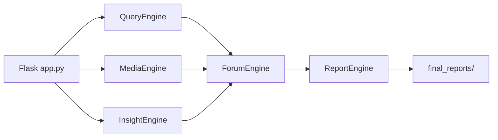

# 666ghj/Weibo_PublicOpinion_AnalysisSystem

> Multi-agent opinion analysis system for Chinese social networks, with generated HTML reports.

## The problem
Tracking what is said across dozens of platforms requires collecting, reading and synthesizing millions of comments.

## What it actually does
Three agents (Query, Media, Insight) search in parallel; a "forum" with a moderator model has them debate over several rounds; a Report Agent assembles an intermediate representation and then an interactive HTML report (PDF and Markdown possible). A MindSpider crawler feeds a PostgreSQL or MySQL database. Sentiment models (BERT, GPT-2 LoRA, Qwen) are provided.

## How it is wired


## Trying it
```bash
docker compose up -d
python app.py
python report_engine_only.py --verbose
```
Copy `.env.example` to `.env` first; interface at http://localhost:5000.

## Cost and gotchas
LLM API keys (OpenAI format) at your expense, a database, Playwright for crawling. The README restricts use to study and research and forbids commercial use, which is in tension with the GPL-2.0. The "advanced configuration" section is marked obsolete.

## What it is not
Not a tool ready for commercial production. Crawling social networks is the user's responsibility. The README's BERT block is visibly truncated (unclosed code block).

## Alternatives
No alternative named in the README (pointers to MiroFish for prediction).

## For you
Worth watching: an instructive multi-agent architecture with debate and a report pipeline; clarify the license before any use.
