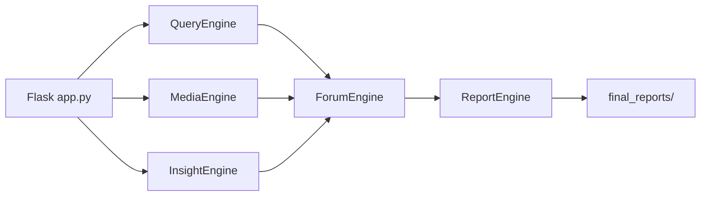

# 666ghj/Weibo_PublicOpinion_AnalysisSystem

> Système multi-agents d'analyse d'opinion sur les réseaux sociaux chinois, avec rapports HTML générés.

## Le problème
Suivre ce qui se dit sur des dizaines de plateformes demande de collecter, lire et synthétiser des millions de commentaires.

## Ce que ça fait vraiment
Trois agents (Query, Media, Insight) cherchent en parallèle ; un « forum » avec un modèle modérateur les fait débattre sur plusieurs tours ; un Report Agent assemble une représentation intermédiaire puis un rapport HTML interactif (PDF et Markdown possibles). Un crawler MindSpider alimente une base PostgreSQL ou MySQL. Modèles de sentiment (BERT, GPT-2 LoRA, Qwen) fournis.

## Comment c'est branché


## Essayer
```bash
docker compose up -d
python app.py
python report_engine_only.py --verbose
```
Copier d'abord `.env.example` en `.env` ; interface sur http://localhost:5000.

## Coût et pièges
Clés d'API LLM (format OpenAI) à ta charge, base de données, Playwright pour le crawl. Le README limite l'usage à l'étude et à la recherche et interdit l'usage commercial, ce qui entre en tension avec la GPL-2.0. Section « configuration avancée » marquée obsolète.

## Ce que ce n'est pas
Pas un outil prêt pour la production commerciale. Le crawl de réseaux sociaux relève de la responsabilité de l'utilisateur. Bloc BERT du README visiblement tronqué (bloc de code non fermé).

## Alternatives
Aucune alternative nommée dans le README (renvois vers MiroFish pour la prédiction).

## Pour toi
Surveiller : architecture multi-agents avec débat et pipeline de rapport instructive ; clarifier la licence avant tout usage.

