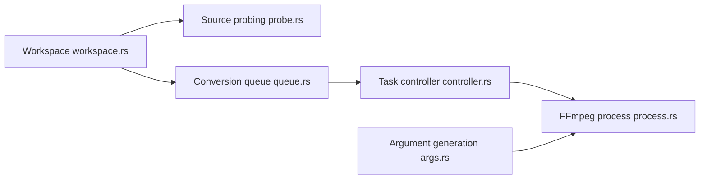

# 66HEX/frame

> Rust desktop application to convert video, audio and images with FFmpeg, with detailed settings.

## The problem
FFmpeg is powerful but its arguments are hard to compose by hand.

## What it actually does
GPUI-CE interface on top of a `frame-core` core that generates FFmpeg arguments, probes sources, validates compatibility and tracks progress. H.264, H.265, VP9, ProRes and AV1 encoders, VideoToolbox and NVENC acceleration, filters, subtitles, metadata, a queue of concurrent tasks, update through a signed manifest.

## How it is wired


## Trying it
```bash
winget install --id 66HEX.Frame -e
brew tap 66HEX/frame
brew install --cask frame
flatpak install flathub io.github._66HEX.Frame
cargo xtask run
```

## Cost and gotchas
Free. Unsigned binaries (macOS ad hoc without notarization, SmartScreen on Windows). FFmpeg is under GPLv3 and so is the project.

## What it is not
Not a scriptable batch processing tool: it is a graphical application.

## Alternatives
No alternative named in the README.

## For you
Ignore: graphical layer over FFmpeg; the command line is more practical for preparing audio or video datasets.
