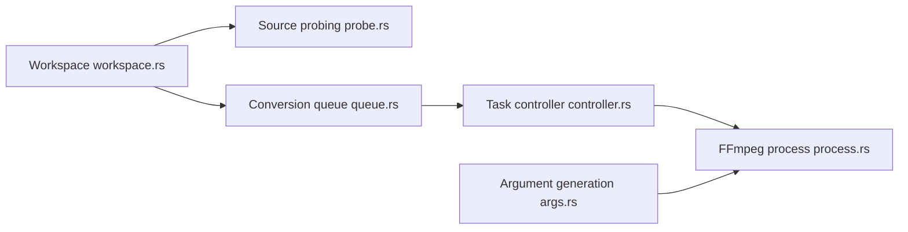

# 66HEX/frame

> Application de bureau Rust pour convertir vidéo, audio et images avec FFmpeg, réglages détaillés à l'appui.

## Le problème
FFmpeg est puissant mais ses arguments sont difficiles à composer à la main.

## Ce que ça fait vraiment
Interface GPUI-CE au-dessus d'un noyau `frame-core` qui génère les arguments FFmpeg, sonde les sources, valide la compatibilité et suit la progression. Encodeurs H.264, H.265, VP9, ProRes, AV1, accélération VideoToolbox et NVENC, filtres, sous-titres, métadonnées, file de tâches concurrentes, mise à jour par manifeste signé.

## Comment c'est branché


## Essayer
```bash
winget install --id 66HEX.Frame -e
brew tap 66HEX/frame
brew install --cask frame
flatpak install flathub io.github._66HEX.Frame
cargo xtask run
```

## Coût et pièges
Gratuit. Binaires non signés (macOS ad hoc sans notarisation, SmartScreen sur Windows). FFmpeg est sous GPLv3 et le projet aussi.

## Ce que ce n'est pas
Pas un outil de traitement en lot scriptable : c'est une application graphique.

## Alternatives
Aucune alternative nommée dans le README.

## Pour toi
À ignorer : surcouche graphique de FFmpeg ; la ligne de commande est plus pratique pour préparer des jeux de données audio ou vidéo.

