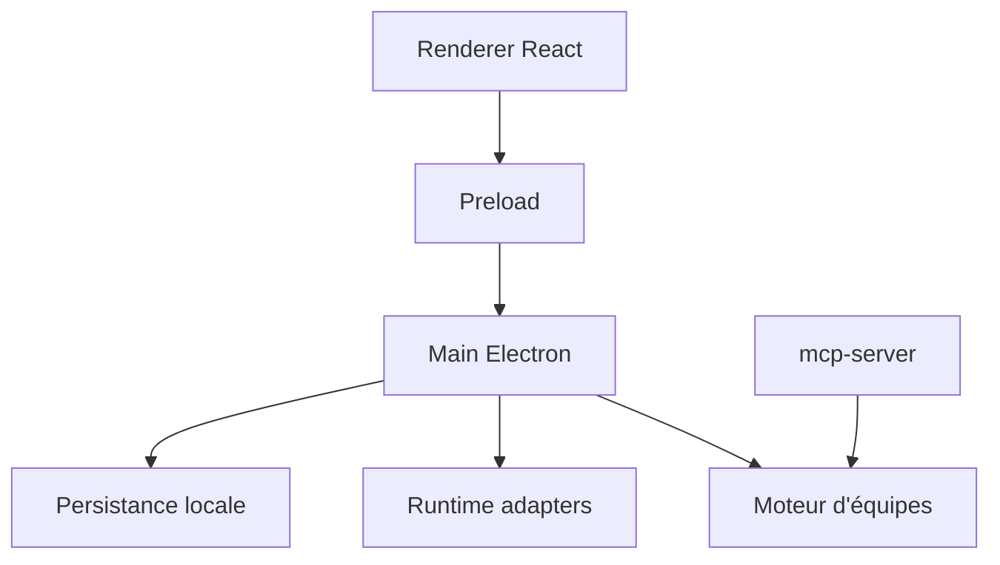

# 777genius/agent-teams-ai

> Electron desktop application that orchestrates teams of AI agents with a kanban, diff review and token budgets.

## The problem
Coordinating several coding agents without a visual interface makes tracking tasks, reviews and costs tedious.

## What it actually does
Monorepo: Electron application (main, preload, renderer), MCP server, Nuxt site and a graph package. The team engine handles creation, members, tasks, comments, messages between teams and reviews. Claude, Codex and OpenCode runtimes are detected locally. State is stored in JSON files, with no database.

## How it is wired


## Trying it
```bash
git clone https://github.com/777genius/agent-teams-ai.git
cd agent-teams-ai
pnpm install
pnpm dev
```

## Cost and gotchas
Free for the model without authentication; providers' subscriptions or API keys are at your expense. AGPL-3.0. On Linux, `AGENT_TEAMS_DISABLE_GPU=1` helps with a white screen over RDP.

## What it is not
Not a cloud: the author states that no code is sent to his servers, but external runtimes talk to their providers. README truncated in the supplied material. Same repository as `claude_agent_teams_ui` according to the sheet (same README, same date).

## Alternatives
The README compares it with Gas Town, Paperclip, Cursor, Claude Code CLI and OpenRig.

## For you
Watch: used to supervise coding agents in parallel; the architecture is well described, but the AGPL license weighs if you want to embed it.
