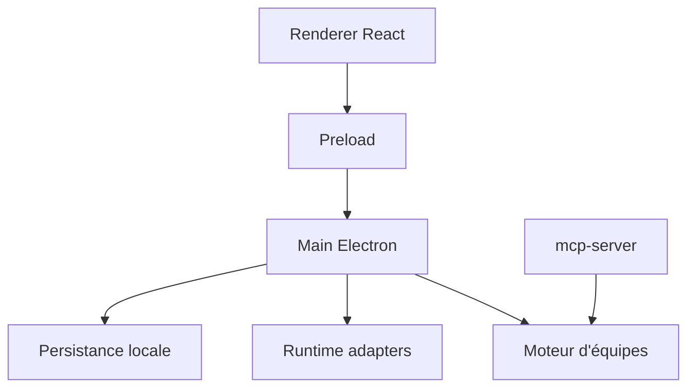

# 777genius/agent-teams-ai

> Application de bureau Electron qui orchestre des équipes d'agents IA avec kanban, revue de diff et budgets de jetons.

## Le problème
Coordonner plusieurs agents de code sans interface visuelle rend le suivi des tâches, des revues et des coûts fastidieux.

## Ce que ça fait vraiment
Monorepo : application Electron (main, preload, renderer), serveur MCP, site Nuxt et paquet de graphes. Le moteur d'équipes gère création, membres, tâches, commentaires, messages entre équipes et revues. Les runtimes Claude, Codex et OpenCode sont détectés localement. L'état est stocké dans des fichiers JSON, sans base de données.

## Comment c'est branché


## Essayer
```bash
git clone https://github.com/777genius/agent-teams-ai.git
cd agent-teams-ai
pnpm install
pnpm dev
```

## Coût et pièges
Gratuit pour le modèle sans authentification ; les abonnements ou clés d'API des fournisseurs sont à ta charge. AGPL-3.0. Sous Linux, `AGENT_TEAMS_DISABLE_GPU=1` aide en cas d'écran blanc via RDP.

## Ce que ce n'est pas
Pas un cloud : l'auteur affirme qu'aucun code n'est envoyé à ses serveurs, mais les runtimes externes parlent à leurs fournisseurs. README tronqué dans la matière fournie. Même dépôt que `claude_agent_teams_ui` d'après la fiche (même README, même date).

## Alternatives
Le README compare avec Gas Town, Paperclip, Cursor, Claude Code CLI et OpenRig.

## Pour toi
À surveiller : sert à superviser des agents de code en parallèle ; l'architecture est bien décrite, mais la licence AGPL pèse si tu veux l'embarquer.

