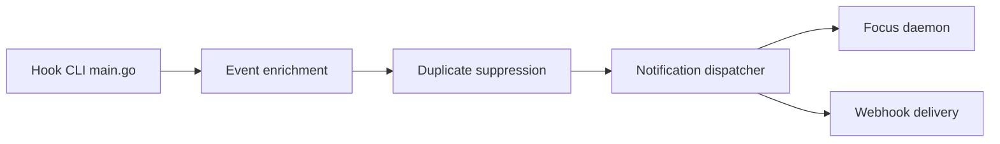

# 777genius/claude-notifications-go

> Desktop notifications and sounds when Claude Code or Codex finishes or waits for approval.

## The problem
You leave an agent running and miss the moment it finishes or waits for a permission.

## What it actually does
A Go CLI receives hook events, adds project, branch and session, filters and deduplicates. It sends a notification, a sound or a webhook (Slack, Discord, Telegram…). A click brings you back to the originating terminal.

## How it is wired


## Trying it
```bash
(set -o pipefail; curl -fsSL https://raw.githubusercontent.com/777genius/agent-notifications/a512deb5819c3f8c7c3be8335f713cc8bb734fc3/bin/setup.sh | bash)
agent-notifications config path
```

## Cost and gotchas
Free. Installation runs a downloaded script (pinned to a commit). Under Codex, you must review and approve the installed hooks.

## What it is not
Not a cost or log tracking tool. The README announces GPL-3.0-or-later, whereas the catalogue declares no license, and the CLA allows an additional commercial license.

## Alternatives
No alternative named in the README.

## For you
Adopt: a small concrete gain if you run long tasks with an agent, keeping an eye on the GPL license.
