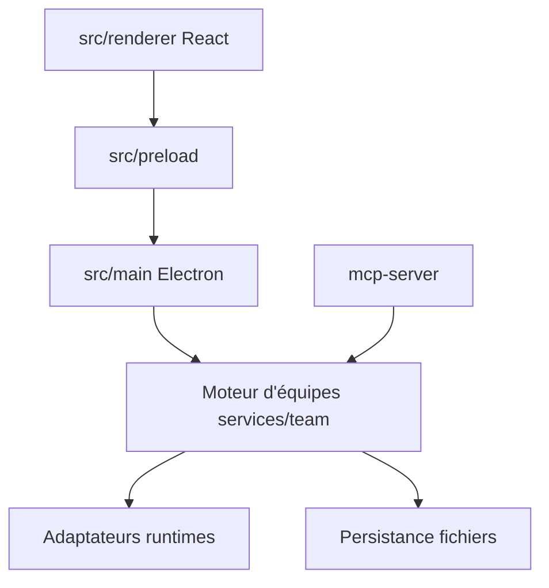

# 777genius/claude_agent_teams_ui

> Desktop application that orchestrates teams of AI agents with a kanban board, code review and budgets.

## The problem
Driving several coding agents in parallel in terminals is hard to follow: who does what, and at what cost.

## What it actually does
Creates teams of agents (Claude Code, Codex, OpenCode, Cursor and others) that split tasks on a kanban, talk to each other and review each other. Offers diff review with accept, reject or comment, an integrated terminal, an editor, Git worktrees, and token analysis with budgets. A free model without authentication lets you get started.

## How it is wired


## Trying it
```bash
git clone https://github.com/777genius/agent-teams-ai.git
cd agent-teams-ai
pnpm install
pnpm dev
```

## Cost and gotchas
Free application; paid providers remain at your expense. AGPL-3.0. Windows may show SmartScreen. Build: Node.js 24 or 26 and pnpm.

## What it is not
Not a model nor an API: it orchestrates existing runtimes. README truncated in the supplied material: the rest was not read. The comparison scores are editorial, not benchmarks.

## Alternatives
The README compares it with Gas Town, Paperclip, Cursor, Claude Code CLI and OpenRig.

## For you
Watch: useful for supervising coding agents as a team; the comparison table comes from the author, so check it yourself.
