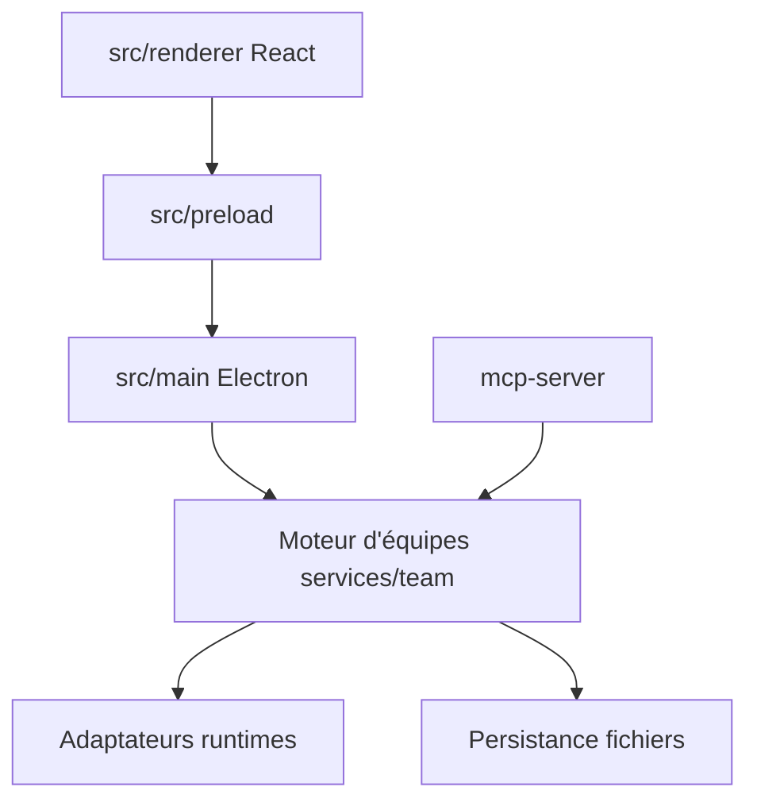

# 777genius/claude_agent_teams_ui

> Application de bureau qui orchestre des équipes d'agents IA avec tableau kanban, revue de code et budgets.

## Le problème
Piloter plusieurs agents de code en parallèle dans des terminaux est difficile à suivre : qui fait quoi, à quel coût.

## Ce que ça fait vraiment
Crée des équipes d'agents (Claude Code, Codex, OpenCode, Cursor et d'autres) qui se répartissent des tâches sur un kanban, se parlent et se relisent. Propose revue de diff avec accepter, rejeter ou commenter, terminal intégré, éditeur, worktrees Git, analyse des jetons avec budgets. Un modèle gratuit sans authentification permet de démarrer.

## Comment c'est branché


## Essayer
```bash
git clone https://github.com/777genius/agent-teams-ai.git
cd agent-teams-ai
pnpm install
pnpm dev
```

## Coût et pièges
Application gratuite ; les fournisseurs payants restent à ta charge. AGPL-3.0. Windows peut afficher SmartScreen. Compilation : Node.js 24 ou 26 et pnpm.

## Ce que ce n'est pas
Pas un modèle ni une API : il orchestre des runtimes existants. README tronqué dans la matière fournie : la suite n'est pas lue. Les scores de comparaison sont éditoriaux, pas des benchmarks.

## Alternatives
Le README compare avec Gas Town, Paperclip, Cursor, Claude Code CLI et OpenRig.

## Pour toi
À surveiller : utile pour superviser des agents de code en équipe ; le tableau comparatif vient de l'auteur, donc à vérifier toi-même.

