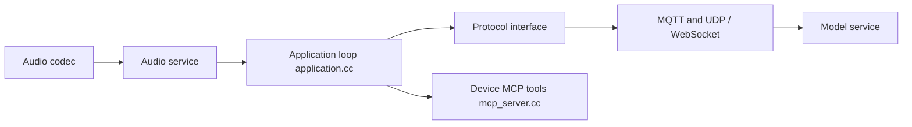

# 78/xiaozhi-esp32

> ESP32 firmware for an LLM-driven voice chatbot, for tinkerers of connected objects.

## The problem
Giving an LLM a voice interface on inexpensive hardware, without building the audio, network and server chain yourself.

## What it actually does
Firmware for many ESP32 boards: offline voice wake-up (ESP-SR), Opus audio stream, voice recognition, WebSocket or MQTT+UDP transport, screens with emojis, camera on some boards, 39 languages. A device-side MCP server controls the speaker, LEDs, servo, GPIO. By default the firmware connects to the official xiaozhi.me server; personal servers (Python, Java, Go) exist in third-party repositories.

## How it is wired


## Trying it
```bash
git submodule update --init --recursive
idf.py fullclean
```
(To be run in ESP-IDF and in the project after an SDK change; ESP-IDF v6.0.1 minimum, `release/v6.1` recommended.)

## Cost and gotchas
ESP32 board to buy. The ready-to-flash firmware goes through the xiaozhi.me server, with an account (free real-time Qwen model for individuals). Documentation largely in Chinese.

## What it is not
Not a standalone offline voice assistant: recognition, the LLM and speech synthesis run server-side.

## Alternatives
- xinnan-tech/xiaozhi-esp32-server: self-hosted Python server cited in the README.
- huangjunsen0406/py-xiaozhi: Python client.

## For you
Worth watching: a concrete example of MCP and voice on embedded hardware; useful for an AI object prototype, otherwise far from your daily data work.
