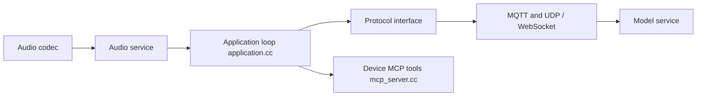

# 78/xiaozhi-esp32

> Firmware ESP32 d'un chatbot vocal piloté par LLM, pour bricoleurs d'objets connectés.

## Le problème
Donner une interface vocale à un LLM sur du matériel peu coûteux, sans monter soi-même la chaîne audio, réseau et serveur.

## Ce que ça fait vraiment
Firmware pour de nombreuses cartes ESP32 : réveil vocal hors ligne (ESP-SR), flux audio Opus, reconnaissance de la voix, transport WebSocket ou MQTT+UDP, écrans avec émojis, caméra sur certaines cartes, 39 langues. Un serveur MCP côté appareil commande haut-parleur, LED, servo, GPIO. Le firmware se connecte par défaut au serveur officiel xiaozhi.me ; des serveurs personnels (Python, Java, Go) existent dans des dépôts tiers.

## Comment c'est branché


## Essayer
```bash
git submodule update --init --recursive
idf.py fullclean
```
(À lancer dans ESP-IDF et dans le projet après un changement de SDK ; ESP-IDF v6.0.1 minimum, `release/v6.1` conseillé.)

## Coût et pièges
Carte ESP32 à acheter. Le firmware prêt à flasher passe par le serveur xiaozhi.me, avec un compte (modèle Qwen temps réel gratuit pour les particuliers). Documentation en grande partie en chinois.

## Ce que ce n'est pas
Pas un assistant vocal autonome hors ligne : la reconnaissance, le LLM et la synthèse vocale tournent côté serveur.

## Alternatives
- xinnan-tech/xiaozhi-esp32-server : serveur Python auto-hébergé cité dans le README.
- huangjunsen0406/py-xiaozhi : client Python.

## Pour toi
À surveiller : exemple concret de MCP et de voix sur du matériel embarqué ; utile pour un prototype d'objet IA, sinon éloigné de ton quotidien data.

