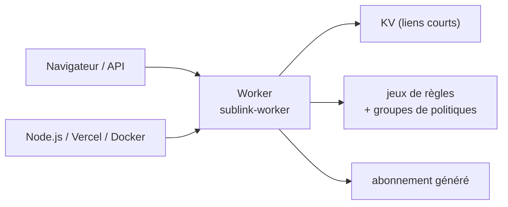

# 7Sageer/sublink-worker

> Proxy subscription converter deployed as a Worker, with a web interface and short links.

## The problem
Proxy clients each expect their own subscription format; converting by hand or relying on a third-party public converter means entrusting your server lists to someone else.

## What it actually does
Imports subscriptions from several sources and generates short links, fixed or random, stored in a KV. Provides a web interface with predefined rule sets and customizable policy groups, a light/dark theme, and an API for scripting. Multilingual: Chinese, English, Persian, Russian. The README describes neither the input formats nor the output formats.

## How it is wired


## Trying it
```bash
npm run build:node && node dist/node-server.cjs
vercel deploy
docker pull ghcr.io/7sageer/sublink-worker:latest
docker compose up -d
```

## Cost and gotchas
Free, but the "one-click" deployment assumes an account with the Worker host, and the short-links KV is configured in the project settings. Docker Compose bundles a Redis.

## What it is not
Not a VPN or a proxy: it only transforms subscription descriptors. The README is only a few lines long and documents no option, so nothing can be verified before running it. The repository carries an explicit warning: for learning use, user's responsibility.

## Alternatives
No alternative named in the README.

## For you
Outside the data / AI / MLOps scope: nothing to take from it.
