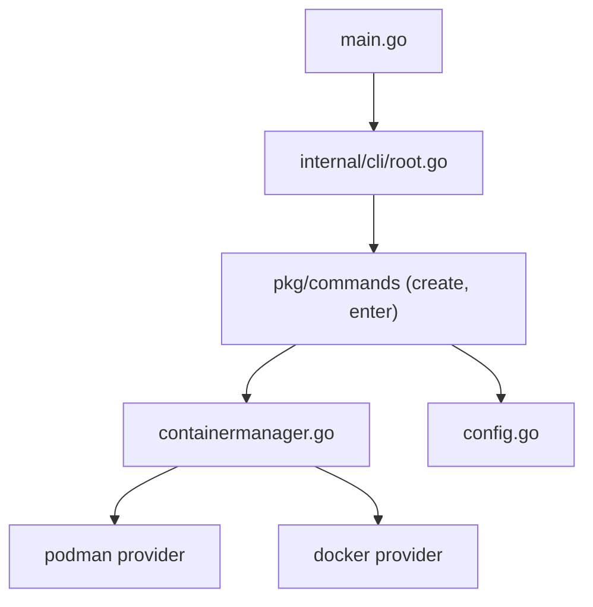

# 89luca89/distrobox

> Run any Linux distribution in a container integrated with the host, from the terminal.

## The problem
An immutable or locked-down system does not let you freely install packages from another distribution.

## What it actually does
A wrapper around podman, docker or lilipod: creates a container sharing your HOME, X11 and Wayland, audio, USB keys, the SSH agent. Subcommands `create`, `enter`, `list`, `stop`, `rm`, `upgrade`, `assemble`, `ephemeral`. A Go binary for v2, POSIX scripts inside the container. GPU is possible via nvidia-container-toolkit.

## How it is wired


## Trying it
```console
distrobox create -n test
distrobox enter test
distrobox list
distrobox rm test
```

## Cost and gotchas
Free; requires podman, docker or lilipod. Isolation is not a goal: the container has access to your HOME. In root mode (docker), it can modify the host system. The Go v2 is a release candidate; v1 is the stable line.

## What it is not
It is not a security sandbox or a virtual machine. Its v2 configuration is read as INI, without shell expansion.

## Alternatives
Litterbox, cited for stronger isolation.

## For you
Worth watching: handy for disposable Linux environments alongside a locked-down workstation, but beware of the extended privileges.
