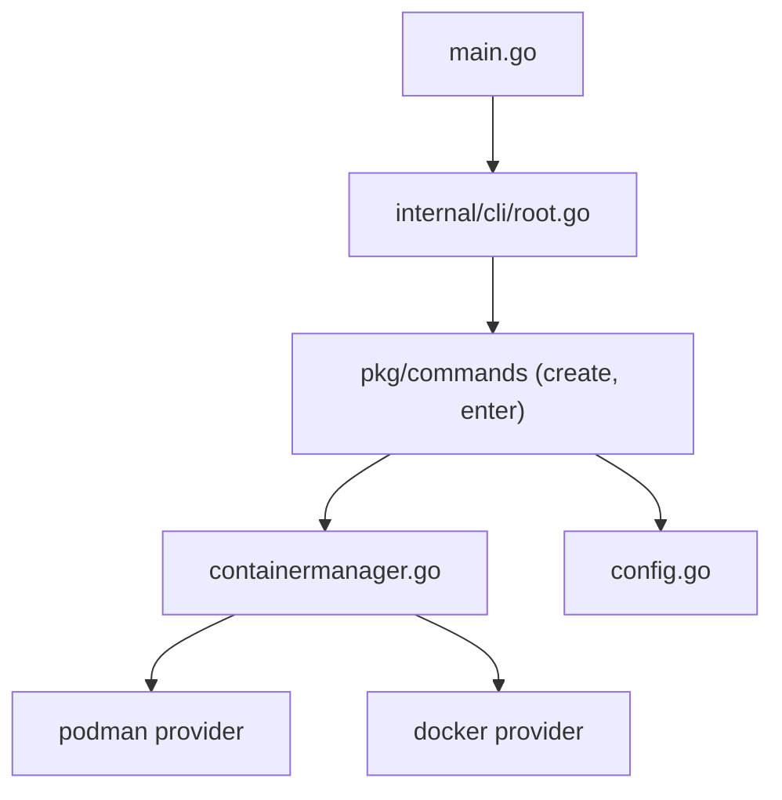

# 89luca89/distrobox

> Lance n'importe quelle distribution Linux dans un conteneur intégré à l'hôte, depuis le terminal.

## Le problème
Un système immuable ou verrouillé ne permet pas d'installer librement des paquets d'une autre distribution.

## Ce que ça fait vraiment
Enveloppe autour de podman, docker ou lilipod : crée un conteneur partageant ton HOME, X11 et Wayland, l'audio, les clés USB, l'agent SSH. Sous-commandes `create`, `enter`, `list`, `stop`, `rm`, `upgrade`, `assemble`, `ephemeral`. Un binaire Go pour la v2, des scripts POSIX dans le conteneur. Le GPU est possible via nvidia-container-toolkit.

## Comment c'est branché


## Essayer
```console
distrobox create -n test
distrobox enter test
distrobox list
distrobox rm test
```

## Coût et pièges
Gratuit ; il faut podman, docker ou lilipod. L'isolation n'est pas un but : le conteneur accède à ton HOME. En mode root (docker), il peut modifier le système hôte. La v2 en Go est une version candidate ; la v1 est la ligne stable.

## Ce que ce n'est pas
Ce n'est pas un bac à sable de sécurité ni une machine virtuelle. Sa configuration en v2 est lue comme INI, sans expansion shell.

## Alternatives
Litterbox, cité pour l'isolation renforcée.

## Pour toi
À surveiller : pratique pour des environnements Linux jetables à côté d'un poste verrouillé, mais attention aux droits étendus.

