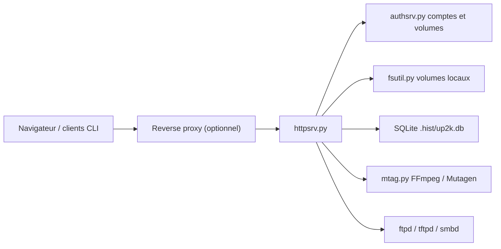

# 9001/copyparty

> Python file server launched from a single file, for transferring and sharing data from a browser.

## The problem
Moving large files between machines requires installing an FTP, WebDAV or Nextcloud server, configuring accounts and protocols, and interrupted transfers start over from scratch.

## What it actually does
A single Python process exposes folders over HTTP, WebDAV, FTP, SFTP, TFTP and SMB, with accounts and per-volume permissions. The "up2k" upload splits files into verified chunks and resumes after an interruption. A SQLite database `.hist/up2k.db` handles the index, search, deduplication and cancellation of uploads. Thumbnails and tags go through FFmpeg, Pillow or Mutagen if present.

## How it is wired


## Trying it
```bash
python3 -m pip install --user -U copyparty
uv tool run copyparty
python copyparty-sfx.py -e2dsa -a kevin:okgo -v .::r:A,kevin
docker run --rm -it copyparty/ac --help
```

## Cost and gotchas
Free, Python alone is enough; FFmpeg and Pillow are optional. Launched with no arguments, it gives everyone read/write access to the current folder. The README judges SMB "unsafe" and advises against the built-in HTTPS in favor of a reverse proxy.

## What it is not
Neither a Nextcloud (no two-way synchronization, "never be supported") nor object storage. The README itself says "do all the things, and do an okay job" and warns that other tools are sometimes a better fit.

## Alternatives
- Nextcloud: two-way folder synchronization.
- Syncthing: synchronization, cited as compatible with copyparty.
- rclone: mounting and sync client, up to 5x faster according to the README.

## For you
Keep an eye on it: handy for moving large datasets between machines with resumable uploads, but expose it only behind a proxy and with strict accounts, given the range of protocols and a single maintainer.
