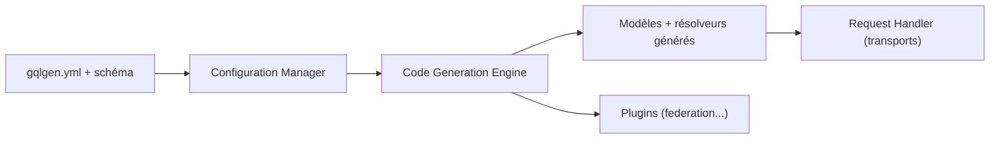

# 99designs/gqlgen

> Go library that generates a typed GraphQL server from a schema, without `map[string]interface{}`.

## The problem
Writing a GraphQL server in Go by hand leads to repetitive, loosely typed code.

## What it actually does
You write the GraphQL schema and a `gqlgen.yml` file; the generator produces Go models and resolver stubs. At runtime, a handler serves requests (HTTP, WebSocket, SSE) with extensions (complexity, introspection, federation). Field resolvers run in goroutines, with a configurable limit (`worker_limit`). Plugins extend the generation.

## How it is wired


## Trying it
```bash
go mod init example
go get -tool github.com/99designs/gqlgen
go tool gqlgen init
go run server.go
```

## Cost and gotchas
Free. The README mentions that you must explicitly request a resolver to avoid loading unnecessary child objects (`forceResolver`), otherwise relations are loaded by default.

## What it is not
Not a GraphQL client nor a "code first" tool: the approach is schema first. It only concerns Go.

## Alternatives
The README points to a comparison with other Go implementations, without naming any.

## For you
Ignore unless your backend is in Go: for Python data/AI it brings you nothing.
