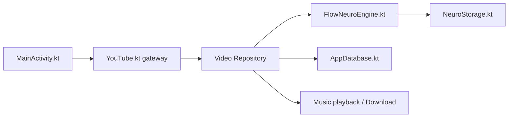

# A-EDev/Flow

> A YouTube and YouTube Music client for Android, with no account, and recommendations computed on the device.

## The problem
Free clients play videos without recommending; the official app tracks you.

## What it actually does
ExoPlayer playback, SponsorBlock, DeArrow, Return YouTube Dislike, downloads, Shorts, music with lyrics. The FlowNeuro engine learns from your views, searches and watch durations, with a transparency dashboard and profile export. Everything stays local, with no account or analytics.

## How it is wired

## Trying it
No command: download an APK from the releases (`flow-arm64-v8a.apk` for most phones).

## Cost and gotchas
Free, Android 8+. Two variants: GitHub (built-in update, Discord Rich Presence) and FOSS. Depends on extracting YouTube streams, so exposed to changes on YouTube's side.

## What it is not
Not a product affiliated with YouTube. The recommendation engine is a local system, not a documented model.

## Alternatives
- NewPipe: source of inspiration, subscription import possible.
- LibreTube: for SponsorBlock and DeArrow.
- MetroList: hybrid music approach.

## For you
Ignore: mainstream mobile app under GPL-3.0, unrelated to a data/AI workflow; only the local recommendation might inspire you.
