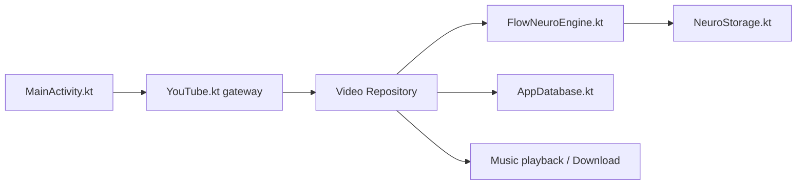

# A-EDev/Flow

> Un client YouTube et YouTube Music pour Android, sans compte, avec recommandations calculées sur l'appareil.

## Le problème
Les clients libres lisent les vidéos sans recommander ; l'application officielle te piste.

## Ce que ça fait vraiment
Lecture ExoPlayer, SponsorBlock, DeArrow, Return YouTube Dislike, téléchargements, Shorts, musique avec paroles. Le moteur FlowNeuro apprend de tes visionnages, saisies et durées, avec tableau de bord de transparence et export du profil. Tout reste local, sans compte ni analytics.

## Comment c'est branché

## Essayer
Aucune commande : télécharger un APK depuis les releases (`flow-arm64-v8a.apk` pour la plupart des téléphones).

## Coût et pièges
Gratuit, Android 8+. Deux variantes : GitHub (mise à jour intégrée, Discord Rich Presence) et FOSS. Dépend de l'extraction des flux YouTube, donc exposé aux changements côté YouTube.

## Ce que ce n'est pas
Pas un produit affilié à YouTube. Le moteur de recommandation est un système local, pas un modèle documenté.

## Alternatives
- NewPipe : base d'inspiration, import d'abonnements possible.
- LibreTube : pour SponsorBlock et DeArrow.
- MetroList : approche musicale hybride.

## Pour toi
Ignorer : application mobile grand public sous GPL-3.0, sans lien avec un flux data/IA ; seule la recommandation locale pourrait t'inspirer.

