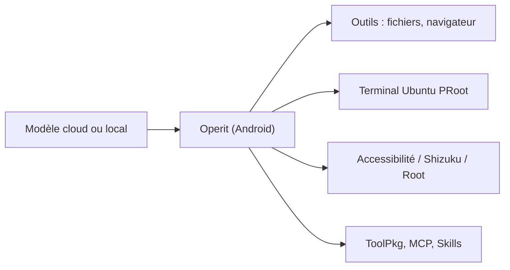

# AAswordman/Operit

> Android AI agent that drives the phone, an Ubuntu terminal and a browser through MCP tools.

## The problem
Mobile assistants chat but do not act on the phone or on project files.

## What it actually does
Android application (ARM64, Android 8+) that connects cloud models (OpenAI, Anthropic, Gemini) or local ones (MNN, GGUF via llama.cpp, Ollama) to tools: files, built-in browser, UI automation via Accessibility, Shizuku or Root, Ubuntu 24.04 terminal via PRoot. It adds graph memory, characters, workflows and an extension marketplace (ToolPkg, MCP, Skills). Web chat and HTTP API, disabled by default.

## How it is wired


## Trying it
```bash
# Aucune commande documentée : télécharger l'APK depuis la page Releases,
# l'installer, puis suivre l'assistant de configuration des modèles.
```

## Cost and gotchas
Model provider key at your expense; memory and storage depend on local models. Accessibility/Root permissions give broad access to the phone.

## What it is not
This repository is the Android edition; Operit 2 (Rust, Flutter, CLI) is a separate project. The build requires external archives.

## Alternatives
No alternative named in the README.

## For you
Worth watching: interesting to see a complete mobile agent, but LGPL, a single maintainer and extended system access call for caution.
